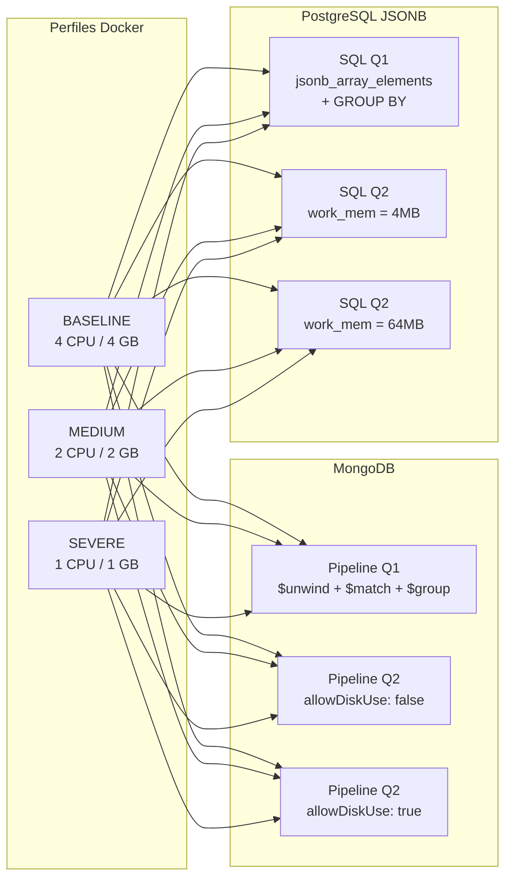
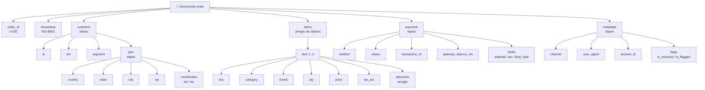
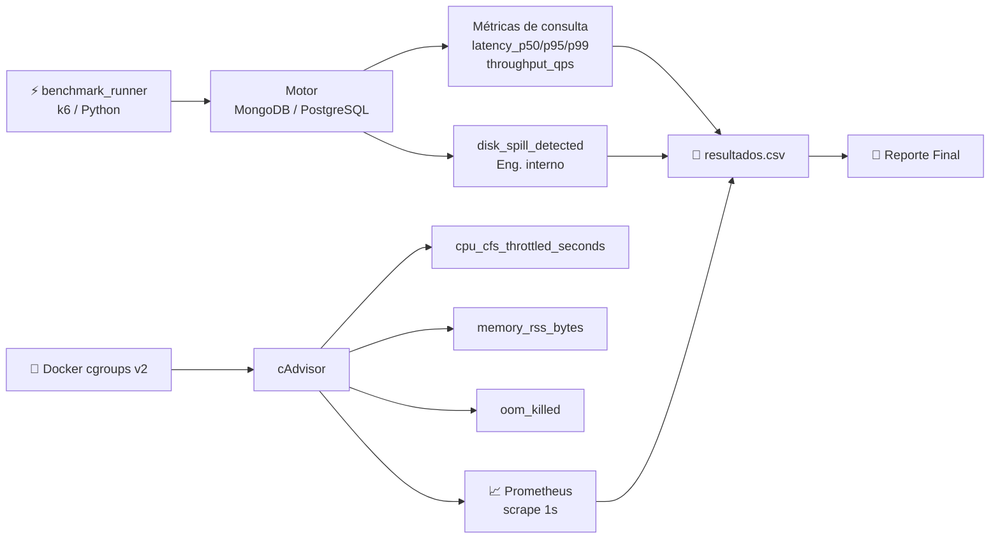
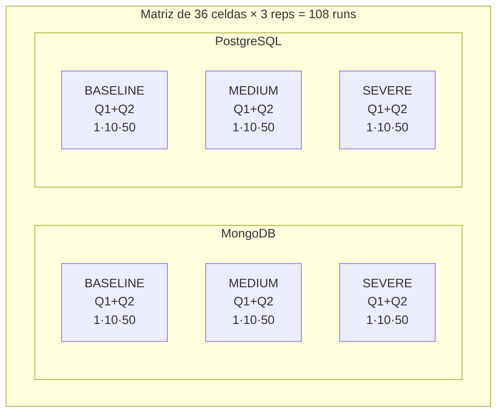
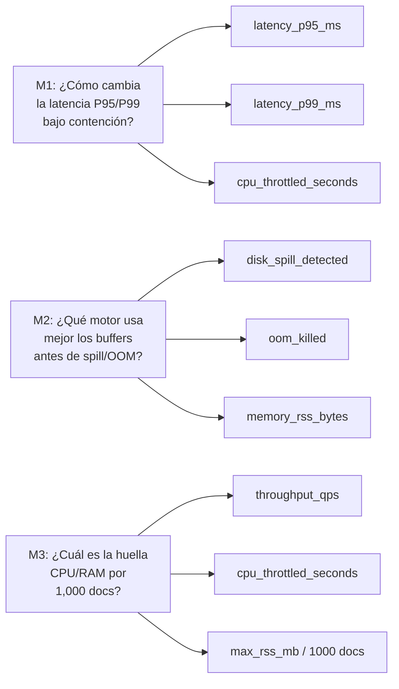
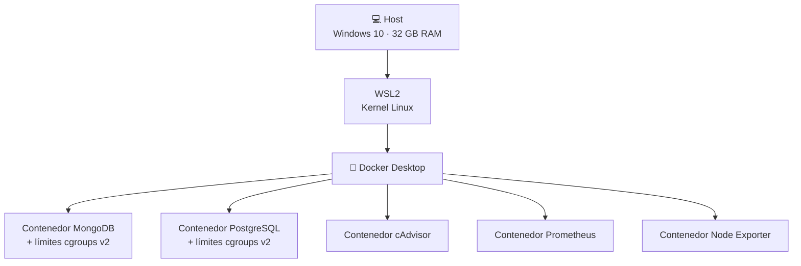

# Grafo de Conocimientos — BDA en la Nube 2026
**Medición de métricas en bases documentales: MongoDB vs PostgreSQL JSONB**

---

## 🗺️ Arquitectura General del Proyecto

```mermaid
flowchart TD
    PROYECTO["🎓 Proyecto BDA en la Nube 2026"]

    PROYECTO --> OBJETIVO["🎯 Objetivo\nMedir latencia, throughput y\nhuella de recursos bajo\ncontención de CPU/RAM"]
    PROYECTO --> MOTORES["🗄️ Motores Comparados"]
    PROYECTO --> DATASET["📦 Dataset"]
    PROYECTO --> EXPERIMENTO["🧪 Diseño Experimental"]
    PROYECTO --> TELEMETRIA["📊 Telemetría"]
    PROYECTO --> ENTREGABLES["📁 Entregables"]

    MOTORES --> MONGO["MongoDB\nlatest-stable\nWiredTiger\nColección orders"]
    MOTORES --> POSTGRES["PostgreSQL\nlatest-stable\nJSONB\nTabla orders"]

    DATASET --> D1["500,000 registros"]
    DATASET --> D2["3 niveles de anidamiento"]
    DATASET --> D3["~3 ítems por orden"]
    DATASET --> D4["synthetic_data_generator.py"]

    EXPERIMENTO --> PERFILES["⚙️ Perfiles Docker"]
    EXPERIMENTO --> QUERIES["📋 Queries"]
    EXPERIMENTO --> PROTOCOLO["🔁 Protocolo"]

    PERFILES --> PA["BASELINE\n4 CPU / 4 GB"]
    PERFILES --> PB["MEDIUM\n2 CPU / 2 GB"]
    PERFILES --> PC["SEVERE\n1 CPU / 1 GB"]

    QUERIES --> Q1["Q1: Unwind+Filter+Group\nSaturación de CPU"]
    QUERIES --> Q2["Q2: Massive Sort+Top-K\nEstrés de buffer/memoria"]

    PROTOCOLO --> CONC["Concurrencia: 1 / 10 / 50"]
    PROTOCOLO --> REPS["Repeticiones: 3"]
    PROTOCOLO --> TOTAL["Total: 108 runs\n36 celdas × 3 reps"]

    TELEMETRIA --> CADVISOR["cAdvisor\ncgroups v2"]
    TELEMETRIA --> NODEEXP["Node Exporter\nHost I/O"]
    TELEMETRIA --> PROMETHEUS["Prometheus\nscrape 1s"]

    ENTREGABLES --> E1["docker-compose.yml"]
    ENTREGABLES --> E2["benchmark_runner/"]
    ENTREGABLES --> E3["queries/"]
    ENTREGABLES --> E4["run_benchmarks.sh"]
    ENTREGABLES --> E5["resultados.csv"]
    ENTREGABLES --> E6["Reporte de métricas"]
```

---

## 🗄️ Relación Motor ↔ Queries ↔ Perfiles

---

## 📦 Estructura del Documento JSON

---

## 📊 Flujo de Métricas y KPIs

---

## 🧪 Matriz Experimental

---

## ❓ Preguntas de Investigación → KPIs

---

## 💻 Entorno de Desarrollo

